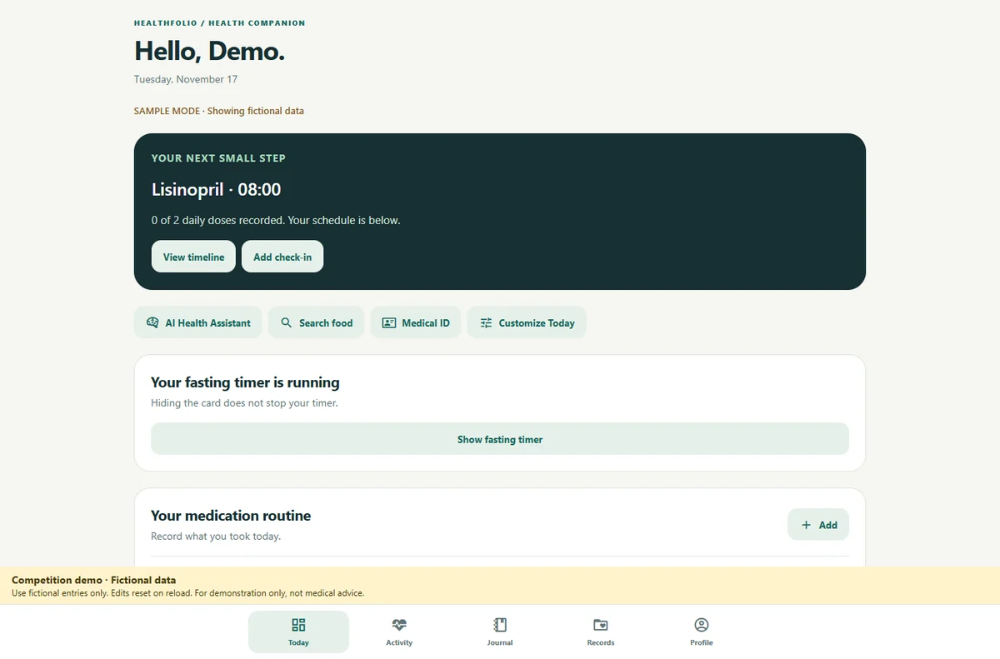

# Healthfolio

A health organizer for medications, symptoms, activity, medical records, and appointment summaries. Built with React Native, Expo, TypeScript, and Swift.

## Web demo

**[Open the live Healthfolio demo](https://healthfolio-demo.vercel.app/)**

The Competition Demo opens with a fictional profile. Try recording a sample dose, filtering the journal and timeline, or preparing a sample visit summary. Use fictional entries only. Edits stay in memory and reset when you reload.

The demo is for demonstration only and does not provide medical advice. Camera and photo attachments, device sync, workout sensors, reminders, and cloud AI are disabled. The health assistant uses built-in rules in the browser.



**[Download the unsigned IPA](https://github.com/Catsarepro21/Congressional-App-Challenge-real/releases/download/ios-build-40424644493-1/SafeScaleHealth-unsigned.ipa)** · [Release notes](https://github.com/Catsarepro21/Congressional-App-Challenge-real/releases/tag/v1.0.0) · [IPA source](https://github.com/Catsarepro21/Congressional-App-Challenge-real/tree/e57d05a19ca7688477eacf1680de1a2fe26a4e57)

## Installation

- The IPA must be signed before it can install and run on an iPhone.
- Apple Health requires HealthKit-enabled signing and permission.
- On-device AI requires compatible hardware and Apple Intelligence; otherwise, local rules are used.
- Camera, location, reminders, and Google Health depend on their permissions and account setup.

Build 109 includes the cleanup and storage-recovery fixes.

## Development

Requires Node.js 22.13 or newer.

```sh
npm ci
npm run web:demo
```

To build and preview the same production web bundle that Vercel serves:

```sh
npm run build:web
npx expo serve --port 4173
```

Open http://localhost:4173. For Vercel, import the repository at its root in a Hobby workspace. The checked-in configuration runs `npm ci` and `npm run build:web`, then publishes `dist/`. No environment variables or external services are required.

`npm run web` starts the original local web app with onboarding. On the native app, select **Profile → Enter Competition Demo** for a fictional walkthrough. Native features require a custom build. Use the **Build iOS IPA (Unsigned)** GitHub workflow, or generate the iOS project on a compatible Mac and open `ios/Healthfolio.xcworkspace`.

